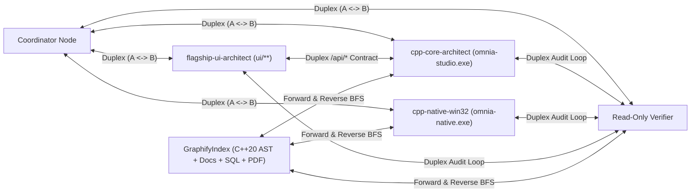

# Bidirectional All-to-All Agent Graph & Graphify Architecture (`PRODUCT-GRAPH`)

> **Audience**: Collaborator **HTMusTC**, Omnia **C++20** & Studio UI maintainers, and Codex / Antigravity / Omnia swarm agents
>
> **Authoritative C++20 & UI Implementation**: [peer_mesh.hpp](../../cpp/include/omnia/graph/peer_mesh.hpp), [peer_mesh.cpp](../../cpp/src/graph/peer_mesh.cpp), [graphify_index.hpp](../../cpp/include/omnia/graph/graphify_index.hpp), [graphify_index.cpp](../../cpp/src/graph/graphify_index.cpp), [test_graph.cpp](../../cpp/tests/test_graph.cpp), and [ui/app/peer-graph.js](../../ui/app/peer-graph.js)
>
> **Related Skills**: [`.agents/skills/deep-general-graph-orchestration`](../../.agents/skills/deep-general-graph-orchestration/SKILL.md), [`.agents/skills/deep-cpp-native`](../../.agents/skills/deep-cpp-native/SKILL.md), [`.agents/skills/autonomous-power-continuity`](../../.agents/skills/autonomous-power-continuity/SKILL.md), [`.agents/skills/omni-bilingual-skill-router`](../../.agents/skills/omni-bilingual-skill-router/SKILL.md)
>
> **Research Qualification Provenance**: `Graphify-Labs/graphify` (`Apache-2.0`, `ADMIT_CONCEPT`, `code_import_admitted = 0`)

---

## 1. Architectural Mandate: 2-Way All-to-All Peer Mesh (`A <-> B`) Over 1-Way Trees

Conventional agent frameworks force communication into a rigid **1-way parent-to-child tree** (`coordinator -> worker -> coordinator`) or a strictly **acyclic pipeline (DAG)**. That restriction creates three structural failure modes in real engineering runs:
1. **Coordinator Bottlenecks**: Sibling authors, build-runner specialists, and read-only verifiers cannot exchange interface contracts or audit findings directly without waking the root coordinator on every intermediate step.
2. **Broken Iterative Repair Loops**: Real verification (`author <-> build-specialist <-> verifier`) is inherently cyclic until `0` defects remain; flattening it into a one-shot DAG either drops repair turns or hides ad-hoc retries outside the graph ledger.
3. **One-Way Context Blindness**: Child or specialist agents cannot query upstream/peer rationale or traverse reverse provenance links (*"what depends on this C++20 header or spec?"*) on demand.

Omnia's native **C++20** `omnia_graph` library (`omnia::graph::PeerMeshGraph` + `omnia::graph::GraphifyIndex`), exposed live via `omnia-studio.exe` (`/api/graph/snapshot`, `/api/graph/send`, `/api/graph/traverse`) and rendered interactively in [ui/app/peer-graph.js](../../ui/app/peer-graph.js), models agent collaboration and codebase/knowledge navigation as a **general bidirectional multigraph**:

---

## 2. Core Invariants of `omnia::graph::PeerMeshGraph` (C++20)

Implemented in [peer_mesh.hpp](../../cpp/include/omnia/graph/peer_mesh.hpp) & [peer_mesh.cpp](../../cpp/src/graph/peer_mesh.cpp) and verified in [test_graph.cpp](../../cpp/tests/test_graph.cpp) (`test_omnia_graph` CTest suite):

| Capability | 1-Way Hierarchy / DAG Legacy | Omnia C++20 Bidirectional General Graph (`PeerMeshGraph`) |
| :--- | :--- | :--- |
| **Topology** | `parent -> child` tree or acyclic DAG only | Arbitrary general graph across `AgentRole::{Coordinator,Worker,Specialist,Verifier,Subagent}`: `connect_duplex` (`A <-> B`), `connect_all_to_all`, `connect_directed`, sibling-to-sibling, child-to-parent, and cyclic SCCs |
| **Adjacency Index** | Outgoing children list only | Symmetric `outgoing` + `incoming` + `duplex_peers` indexes providing `O(1)` forward and reverse peer lookup |
| **Message Primitives** | One-shot prompt in, single final string out | Full-duplex `send_peer`, auto-reverse `reply`, `broadcast`, and cursor-based `read_since(agent_id, since_seq)` wakeup (zero-cost sleep while waiting) |
| **Write Isolation** | Implicit or unguarded shared workspace | Explicit `owned_paths` + `excluded_paths` disjoint ownership guard (`AgentGraphError::Code::OwnershipConflict`) rejecting overlapping concurrent write scopes before mutation |
| **Cycle & Epoch Control** | Cycles rejected as graph errors | Intentional cycles permitted with explicit `max_hops` (`HopBudgetExceeded`), monotonic `epoch` fencing (`bump_agent_epoch` / `StaleEpoch`), and `detect_stalled_conversations` |
| **Out-of-Source Build Isolation** | Competing in-tree compiler outputs | Disjoint external CMake + Ninja build directories (`D:\OmniaData\build\omnia-cpp-core-*` vs `omnia-cpp-native-*`) gated by `OMNIA_BUILD_NATIVE_SHELL` |

---

## 3. Graphify-Inspired Bidirectional Code & Knowledge Graph (`omnia::graph::GraphifyIndex`)

Qualified from `Graphify-Labs/graphify` (`Apache-2.0`, clean-room architectural concept admission with **zero** third-party code copied into Omnia) and implemented in [graphify_index.hpp](../../cpp/include/omnia/graph/graphify_index.hpp) & [graphify_index.cpp](../../cpp/src/graph/graphify_index.cpp):

1. **Deterministic Multi-Artifact Entity & Edge Indexing**:
   - Connects `GraphifyEntityKind::{Agent,CodeModule,Symbol,Skill,MemoryNote,Artifact,Requirement}` across C++20 headers/sources, Flagship Studio JS/CSS modules, Markdown governance & handoff specs ([GOAL.md](../workspace/GOAL.md), [DOD.md](../workspace/DOD.md), [DECISIONS.md](../workspace/DECISIONS.md)), `winsqlite3` schemas, `CMakeLists.txt` / JSON configs, and reference PDFs into one local queryable graph—**without** requiring an external vector database.
2. **Bidirectional `O(1)` Incidence & BFS Traversal (`TraversalDirection::{Forward,Reverse,Both}`)**:
   - Every relationship is indexed in both `outgoing_edges(id)` and `incoming_edges(id)` and traversable via `traverse_bfs(start_id, direction, max_depth, include_ambiguous)`:
     - **Forward (`Forward`)**: `module -> defines -> symbol`, `spec -> requires -> test`, `studio_server -> calls -> router`.
     - **Reverse (`Reverse`)**: `symbol -> defined_in -> module`, `test -> verifies -> spec`, `router -> called_by -> studio_server` (answering *"what breaks or needs re-verification if I edit this header?"* in `O(degree)`).
3. **Explicit Three-Tier Epistemic Provenance (`GraphifyProvenance`)**:
   - `Extracted` (`10000` bps default): Deterministically parsed from C++20/CMake syntax, SQL foreign keys, or explicit file/URI links.
   - `Inferred`: Derived from structural clustering, symbol resolution, or cross-document correspondence with recorded `rationale`.
   - `Ambiguous` (**quarantined by default**): Retained in `GraphifyTraversalResult::quarantined_ambiguous` when `include_ambiguous == false` rather than silently merged into active traversal paths.
4. **Interactive Studio Visualization ([ui/app/peer-graph.js](../../ui/app/peer-graph.js))**:
   - Renders High-DPI `A <-> B` duplex peer channels, animated directional message pulses (`POST /api/graph/send`), `disjoint_paths` ownership inspectors, and live `Forward` / `Reverse` / `Both` `GraphifyIndex` BFS neighborhoods (`POST /api/graph/traverse`).

---

## 4. Four-Way Workflow Synchronization (Omnia + Codex + `~/.agents` + Antigravity)

*(Historical Wave 2–3 Rust reference remains archived on pushed Git tag `archive/pre-cpp-rust-snapshot-20261112`.)*

This bidirectional peer-mesh and Graphify architecture is synchronized byte-for-byte across all `13` curated skills and active host configurations:
- **Omnia Repository ([`.agents/skills/`](../../.agents/skills/) + [cpp/src/harness/skill_registry.cpp](../../cpp/src/harness/skill_registry.cpp))**: `deep-general-graph-orchestration`, `deep-cpp-native`, `autonomous-power-continuity`, and `omni-bilingual-skill-router` (`omnia-bidirectional-peer-graph` pipeline).
- **Codex (`~/.codex/skills/` & `~/.codex/AGENTS.md`)** and **Global Agent Skills (`~/.agents/skills/`)**: Byte-identical pure UTF-8 `LF` skill packages validated via `quick_validate.py` and `verify_pack.py`.
- **Antigravity (`~/.gemini/config/skills.json` + `~/.gemini/GEMINI.md`)**: Global rule enforcement in `~/.gemini/GEMINI.md` (Sections 2 & 3) plus 4-root drive-absolute Windows skill mounting in `~/.gemini/config/skills.json`.
