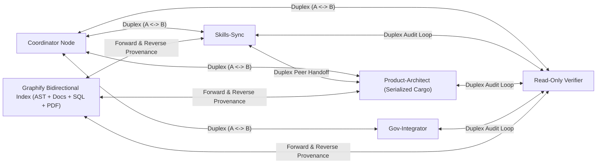

# Bidirectional All-to-All Agent Graph & Graphify Architecture (`PRODUCT-GRAPH`)

> **Audience**: Collaborator **HTMusTC**, Omnia Rust maintainers, and Codex / Antigravity / Omnia swarm agents
>
> **Related Skills**: `.agents/skills/deep-general-graph-orchestration`, `.agents/skills/autonomous-power-continuity`, `.agents/skills/omni-bilingual-skill-router`
>
> **Research Qualification Provenance**: `Graphify-Labs/graphify` (`Apache-2.0`, `ADMIT_CONCEPT`, `code_import_admitted = 0`)

---

## 1. Architectural Mandate: 2-Way All-to-All Peer Mesh (`A <-> B`) Over 1-Way Trees

Conventional agent frameworks force communication into a rigid **1-way parent-to-child tree** (`coordinator -> worker -> coordinator`) or a strictly **acyclic pipeline (DAG)**. That restriction creates three structural failure modes in real engineering runs:
1. **Coordinator Bottlenecks**: Sibling authors, build-lock runners, and read-only verifiers cannot exchange interface contracts or audit findings directly without waking the root coordinator on every intermediate step.
2. **Broken Iterative Repair Loops**: Real verification (`author <-> build-runner <-> verifier`) is inherently cyclic until `0` defects remain; flattening it into a one-shot DAG either drops repair turns or hides ad-hoc retries outside the graph ledger.
3. **One-Way Context Blindness**: Child or specialist agents cannot query upstream/peer rationale or traverse reverse provenance links (`what depends on this symbol/spec?`) on demand.

Omnia's orchestration model (`PeerMeshGraph` in `omnia-harness` + synchronized Codex/Omnia/Antigravity skills) models agent collaboration and codebase/knowledge navigation as a **general bidirectional multigraph**:

---

## 2. Core Invariants of the Bidirectional Agent Graph (`PeerMeshGraph`)

| Capability | 1-Way Hierarchy / DAG Legacy | Omnia Bidirectional General Graph (`PeerMeshGraph`) |
| :--- | :--- | :--- |
| **Topology** | `parent -> child` tree or acyclic DAG only | Arbitrary general graph: `Duplex` (`A <-> B`), all-to-all peer mesh, sibling-to-sibling, child-to-parent, and cyclic SCCs |
| **Adjacency Index** | Outgoing children list only | Symmetric `outgoing` + `incoming` adjacency sets (`O(1)` forward and reverse peer lookup) |
| **Message Primitives** | One-shot prompt in, single final string out | Full-duplex `send_peer`, `broadcast`, `reply`, and cursor-based `read_since(seq)` wakeup (zero-cost sleep while waiting) |
| **Write Isolation** | Implicit or unguarded shared workspace | Explicit `disjoint_paths` ownership guard rejecting overlapping concurrent write scopes before mutation |
| **Cycle Control** | Cycles rejected as graph errors | Intentional cycles permitted with explicit `max_hops`, monotonic `epoch`, stall detection, and falsifiable convergence predicates |
| **Shared Lock Serialization** | Ad-hoc competing compiler invocations | Designated lock-owner peer (for example, serialized Cargo runner with externalized `CARGO_TARGET_DIR`) reachable directly by any peer |

---

## 3. Graphify-Inspired Bidirectional Code & Knowledge Graph (`ADMIT_CONCEPT`)

Qualified from `Graphify-Labs/graphify` (`Apache-2.0`, clean-room architectural concept admission with **zero** third-party code copied into Omnia):

1. **Deterministic Multi-Artifact Indexing (`detect -> extract -> build -> cluster -> analyze -> report`)**:
   - Connects Rust/TS/Python AST symbols (modules, structs, traits, functions, line spans), Markdown governance & handoff specs (`GOAL.md`, `DOD.md`, `DECISIONS.md`), SQLite schemas, TOML/JSON configs, and reference PDFs into one local queryable graph—**without** requiring an external vector store.
2. **Bidirectional Edge Traversal (`Forward` + `Reverse`)**:
   - Every relationship is queryable in both directions:
     - **Forward (`outgoing`)**: `module -> defines -> symbol`, `spec -> requires -> test`, `router -> calls -> provider`.
     - **Reverse (`incoming`)**: `symbol -> defined_in -> module`, `test -> verifies -> spec`, `provider -> called_by -> router` (answering *"what breaks or needs re-verification if I edit this file?"* in `O(degree)`).
3. **Explicit Three-Tier Edge Provenance**:
   - `EXTRACTED`: Deterministically parsed from AST syntax, manifest dependency, SQL foreign key, or explicit file/URI link.
   - `INFERRED`: Derived from structural community clustering (such as Leiden cohesion), symbol resolution, or cross-document correspondence with recorded explanation.
   - `AMBIGUOUS`: Retained candidate relationship where multiple targets match; surfaced honestly rather than merged silently on name similarity.
4. **Graph-First Pre-Tool Discipline**:
   - Agents query symbol neighborhoods, god-node hubs, and reverse dependents first, then read exact `file:line` slices—avoiding noisy whole-repository `grep` dumps while keeping context compact and citations exact.

---

## 4. Three-Way Workflow Synchronization (Codex + Omnia + Antigravity)

This architecture is active across all three agent hosts:
- **Omnia Repository (`.agents/skills/` + `omnia-harness`)**: `.agents/skills/deep-general-graph-orchestration/`, `.agents/skills/autonomous-power-continuity/`, and `.agents/skills/omni-bilingual-skill-router/` (`pipeline omnia-bidirectional-peer-graph`).
- **Codex (`~/.codex/skills/`)**: Byte-identical `LF` skill packages in `~/.codex/skills/{deep-general-graph-orchestration,autonomous-power-continuity,omni-bilingual-skill-router}`.
- **Antigravity (`~/.gemini/config/skills.json` + `~/.gemini/GEMINI.md`)**: Global rule enforcement in `~/.gemini/GEMINI.md` (Sections 2 & 3) plus 4-root skill parity in `~/.gemini/config/skills.json`.
