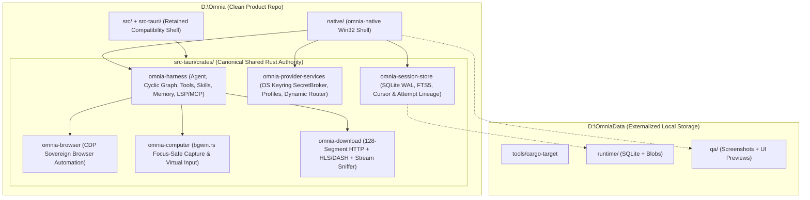

# Omnia — Collaborator Handoff Guide (for HTMusTC)

Welcome to **Omnia** (`https://github.com/khang-macphuc111107/omnia`). This document is the canonical technical onboarding and execution guide prepared from the full multi-host engineering history (Codex, Antigravity Desktop & CLI, and Claude CLI & Desktop) so you can step into UI/UX leadership, skill/prompt hygiene, and native runtime integration without losing a single product decision or architectural invariant.

---

## 1. Executive Vision & Core Product Pillars

Omnia is a **sovereign, native-first desktop AI Agent, Harness, Embedded IDE, Integrated Browser, and 128-Segment Media/File Downloader** engineered for instant responsiveness, zero Electron/WebView bloat on the primary desktop path, and uninterrupted human-in-the-loop control.

### Why "Native Rust" (Clarifying the `2026-11-11` "C++" Performance Note)
In casual planning chat (`2026-11-11`), the performance target was shorthand-described as *"viết sang C++ luôn cho nhanh"* to contrast against sluggish Electron/WebView wrappers. Per [GOAL.md](../workspace/GOAL.md) and [COMPOSER_REQUIREMENTS.md](../workspace/COMPOSER_REQUIREMENTS.md), **Native Rust** (`native/` + `src-tauri/crates/`) is the canonical implementation language: it delivers C++-class zero-GC Win32/DirectWrite speed while sharing 100% of Omnia's existing memory-safe Rust crates (`omnia-harness`, `omnia-session-store`, `omnia-provider-services`, `omnia-browser`, `omnia-computer`, `omnia-download`) without an FFI boundary.

### Seven Non-Negotiable Product Pillars
1. **Flagship Anti-AI-Slop Native UI (`PRODUCT-WORKSPACE`)**: Preview-first visual direction (`docs/ui-direction/DIRECTION_DECISION.md`), measurable typography/contrast/hit-target tokens, crisp 60/120 Hz animations, zero purple-pink gradient soup, zero clipped controls, and zero dead decorative chrome.
2. **Word-Grade Rich Composer + Dual-Mode Inline/Tray Attachments (`PRODUCT-COMPOSER`, `PRODUCT-ATTACHMENTS`)**: Formatting ribbon, live Markdown/LaTeX rendering, visual rendered Math/Physics/Chemistry symbol & equation builders, `Ctrl+V` modal choice (`inline-at-caret` ordered document node vs `attachment tray` sharing one deduplicated payload ID, `Esc` cancel safe), drag-over-editor live insertion caret vs drop-outside-editor to tray, and automatic conversion of unsupported files/folders with full provenance.
3. **Dynamic Multi-Provider / Account / Quota / Latency Router (`PRODUCT-ROUTING`)**: Inspired by `htmustc-proxy` and real-world 429 walls—routes across providers, account pools, models, and reasoning efforts using capability + privacy hard filters, atomic quota reservation + emergency interactive reserve (`quota_stale` / `usage_unknown` explicit, never silently zeroed), EWMA/p95 latency, circuit breakers, and secret-free route receipts.
4. **Hierarchical Tree + Typed Graph Memory (`PRODUCT-MEMORY`)**: Short-term session context + long-term hierarchical `.omnia/{memory,specs,plans,skills,artifacts}` tree + typed graph links with `EXTRACTED` / `INFERRED` / `AMBIGUOUS` provenance, supersession lineage, and erasure receipts.
5. **Proactive Multi-Query Search & Local/Web RAG (`PRODUCT-SEARCH`, `PRODUCT-KNOWLEDGE`)**: Proactively detects broad, ambiguous, or time-sensitive topics without waiting for keywords like `"latest"`, decomposes into diverse web + local-corpus queries, and surfaces cited sources, **unused sources**, and executed queries.
6. **Zero-Focus-Steal Computer/Browser Use + 128-Chunk Downloader + Embedded IDE (`PRODUCT-USE`)**: Background/headless/bottom-z-order window capture (`PrintWindow` / `bgwin.rs`) and virtual cursor/keyboard overlay so Omnia **never hijacks the user's physical mouse or keyboard focus**, paired with CDP browser automation (`omnia-browser`), clean-room 128-segment HTTP/HLS/DASH downloading (`omnia-download`), and an integrated code/LSP workbench.
7. **Live Goal/Plan/Steer/Queue Control (`PRODUCT-GOALS`, `PRODUCT-SUBAGENTS`)**: Live CRUD over goals, plans, and cyclic agent graphs; user `steer` acts strictly as an **additive queue** (finish or cleanly checkpoint interrupted work, resolve conflicts, resume prior backlog—never drop unfinished tasks and never impose unauthorized `token_budget` caps).

---

## 2. Clean-Root Architecture: `D:\Omnia` vs `D:\OmniaData`

A strict repository hygiene boundary governs all development ([GOAL.md](../workspace/GOAL.md), [DOD.md](../workspace/DOD.md)):

- **`D:\Omnia` (Tracked Product Repository ONLY)**:
  - Contains clean Rust/TypeScript source, Cargo manifests, deterministic verification scripts, governance specs (`docs/workspace/`), UI direction (`docs/ui-direction/`), and collaborator handoff (`docs/handoff/`).
  - **NEVER** place `target/`, `node_modules/` build dumps, `.tmp-*` probes, beside-source `.bak` files, QA screenshots, browser profiles, SQLite runtime DBs, or nested git worktrees inside `D:\Omnia`.
- **`D:\OmniaData` (Externalized Build, Runtime, QA, Research & History Root)**:
  - `D:\OmniaData\tools\cargo-target` — shared `CARGO_TARGET_DIR` for all Rust builds/tests.
  - `D:\OmniaData\runtime\` — SQLite WAL session databases, browser profiles, attachment blobs, and local runtime state.
  - `D:\OmniaData\qa\` — native Win32 window captures (`qa-capture.ps1`), paging/smoke receipts, and UI direction interactive HTML/CSS/JS candidate bundles (`ui-direction-20261112/`).
  - `D:\OmniaData\research\` & `D:\OmniaData\exports\history\` — externalized ecosystem intake and redacted multi-host chat history archives (never committed to Git).



---

## 3. Honest Capability Matrix: What Works Today vs What Needs Wiring

Per Omnia's evidence discipline, never confuse backend crate readiness with end-to-end native UI wiring. Here is the exact baseline state across workspaces:

| Subsystem | Location | Works Today (Verified in Rust Tests / QA) | Pending / Ready for HTMusTC & Next Sprints |
|---|---|---|---|
| **Native Desktop Shell (`omnia-native`)** | [native/src/](../../native/src/) (`main.rs`, `win32.rs`, `lib.rs`, `sessions.rs`, `session_panel.rs`, `session_form.rs`) | Instant-startup Win32 shell (`Chat` / `Browser` / `Ide` mode switching), DPI-aware GDI/Win32 layout, real `omnia-session-store` SQLite session list/search/create/rename/archive/delete, `omnia-provider-services` profile inspection, externalized UIA smoke/paging/capture scripts (`native/qa-*.ps1`). | Replace placeholder GDI text panels with flagship DirectWrite/Win32 custom rendering approved from `docs/ui-direction/DIRECTION_DECISION.md`; wire live provider send/stream/cancel, rich composer, attachment tray/inline nodes, and Browser/IDE child viewports. |
| **Agent Harness & Skills** | [omnia-harness](../../src-tauri/crates/omnia-harness/src/) (`agent.rs`, `run_control.rs`, `plan.rs`, `skills.rs`, `subagent.rs`, `memory.rs`, `lsp/`, `mcp/`) | Tool registry, cyclic/bounded workflow execution, permission & effect classes, run-control revisions, subagent spawning, `.omnia/{memory,specs,plans,skills,artifacts}` hierarchical file memory with `[[slug]]` links, LSP & MCP client foundations. | Consolidate & deduplicate external `.codex`/`~/.claude`/`~/.gemini` skill taxonomies (eliminating `deep-*` synonym collisions and 300-char description truncation); upgrade `.omnia/` memory links into full typed provenance graph (`EXTRACTED`/`INFERRED`/`AMBIGUOUS`) + proactive multi-query RAG orchestrator. |
| **Provider Broker & Dynamic Routing** | [omnia-provider-services](../../src-tauri/crates/omnia-provider-services/src/) (`lib.rs`, `profiles.rs`, `routing.rs`) | OS Keyring `SecretBroker` (`Zeroizing` memory hygiene, zero plaintext keys in SQLite), destination policy enforcement, adapter construction (`OpenAiResponses`, `OpenAiChat`, `Anthropic`, `Gemini`), dynamic routing scoring/reservation/circuit-breaker primitives. | Connect live `htmustc-proxy` / multi-account quota telemetry probes (`remaining`, `reset_at`, `quota_stale`, `usage_unknown`), live streaming failover before side-effect commit, and compact router receipt telemetry in the native UI. |
| **Session & Artifact Store** | [omnia-session-store](../../src-tauri/crates/omnia-session-store/src/) | SQLite WAL schema, FTS5 full-text session search, keyset pagination, optimistic concurrency revisions, provider-attempt lineage tables. | Add ordered document-model persistence (`text` + `inline_attachment` + `math_block` + `tray_attachment` sharing deduplicated `payload_id`s) and crash-safe composer draft auto-recovery. |
| **Sovereign Browser & Downloader** | [omnia-browser](../../src-tauri/crates/omnia-browser/src/), [omnia-download](../../src-tauri/crates/omnia-download/src/) | CDP automation, DOM/accessibility snapshotting, clean-room multi-segment HTTP range downloader (up to 128 segments), HLS/M3U8 & DASH stream assembly, checksum/resume journals. | Embed child browser surface inside `omnia-native` `Mode::Browser` + wire media-sniffer grab bar and segment progress drawer. |
| **Focus-Safe Computer Use** | [omnia-computer](../../src-tauri/crates/omnia-computer/src/) (`bgwin.rs`, etc.) | Off-focus/background window capture (`PrintWindow`) and coordinate-mapped window message helpers. | Add dedicated visual **Virtual Cursor / Virtual Keyboard Overlay** toggle + hard policy lock preventing physical `SetCursorPos` / `SendInput` focus theft unless explicitly authorized by the user. |
| **Compatibility Tauri/React Shell** | [src/](../../src/) + [src-tauri/](../../src-tauri/) | Retained reference UI components, CSS tokens, Tauri ACL & command-parity tests (`scripts/check-*.mjs`). | **Freeze against feature divergence**: keep passing CI/parity checks solely as a migration reference until `native/` reaches full functional parity, then retire cleanly. |

---

## 4. Daily Build, Test & QA Workflow

### Prerequisites (Windows 11)
- **Rust Toolchain**: Stable MSVC toolchain (`cargo`, `rustfmt`, `clippy`).
- **Node.js / pnpm** *(only when running retained compatibility checks in `scripts/`)*: Node 22+ / `pnpm`.
- **External Build Target (MANDATORY)**: Always direct Cargo artifacts outside `D:\Omnia` so the product repo stays 100% clean:

```powershell
$env:CARGO_TARGET_DIR = "D:\OmniaData\tools\cargo-target"
```

### Fast Verification Commands

1. **Native Shell (`omnia-native`) — Format, Check & Unit Tests**:
   ```powershell
   $env:CARGO_TARGET_DIR = "D:\OmniaData\tools\cargo-target"
   cargo fmt --manifest-path "D:\Omnia\native\Cargo.toml" --all -- --check
   cargo check --manifest-path "D:\Omnia\native\Cargo.toml" --locked
   cargo test --manifest-path "D:\Omnia\native\Cargo.toml" --locked
   ```

2. **Shared Core Crates (`src-tauri/Cargo.toml` workspace) — Check & Targeted Crate Tests**:
   ```powershell
   $env:CARGO_TARGET_DIR = "D:\OmniaData\tools\cargo-target"
   cargo check --manifest-path "D:\Omnia\src-tauri\Cargo.toml" -p omnia-session-store -p omnia-provider-services -p omnia-harness -p omnia-browser -p omnia-computer -p omnia-download --locked
   cargo test --manifest-path "D:\Omnia\src-tauri\Cargo.toml" -p omnia-provider-services -p omnia-session-store -p omnia-harness --locked
   ```

3. **Native Win32 Smoke, Session, Paging & Focus-Safe Capture QA (`native/qa-*.ps1`)**:
   All native QA scripts automatically write runtime state and screenshots under `D:\OmniaData\qa\` (enforced by [qa-paths.ps1](../../native/qa-paths.ps1) and [qa-guard.ps1](../../native/qa-guard.ps1)):
   ```powershell
   pwsh -NoProfile -File "D:\Omnia\native\qa-paths.tests.ps1"
   pwsh -NoProfile -File "D:\Omnia\native\qa-capture.tests.ps1"
   pwsh -NoProfile -File "D:\Omnia\native\qa-smoke.ps1"
   pwsh -NoProfile -File "D:\Omnia\native\qa-session.ps1"
   pwsh -NoProfile -File "D:\Omnia\native\qa-paging.ps1"
   ```

4. **Repository Cleanliness Check (Run Before Every Commit)**:
   ```powershell
   git -C "D:\Omnia" status --short
   git -C "D:\Omnia" diff --check
   ```

---

## 5. Priority Roadmap for HTMusTC

### Phase 1 — Visual Direction Lock & Native Rendering Foundation (`Week 1`)
- Review the 3 interactive anti-AI-slop HTML/CSS/JS candidate bundles in `D:\OmniaData\qa\ui-direction-20261112\` and the weighted comparison in [DIRECTION_DECISION.md](../ui-direction/DIRECTION_DECISION.md) (`PENDING_USER_REVIEW`).
- Lock typography, contrast (`>= 4.5:1` body, `>= 7:1` primary), spacing grid, hit-target minimums (`>= 32x32 px` desktop interactive controls), and 60/120 Hz micro-animation budgets.
- Upgrade [native/src/win32.rs](../../native/src/win32.rs) from raw GDI placeholder text to crisp DirectWrite / custom-drawn Win32 panels (eliminating the historical status-panel clipping defect and ensuring every interactive composer/search surface exposes proper UI Automation controls).

### Phase 2 — Word-Grade Rich Composer & Dual-Mode Attachment Pipeline (`Weeks 1–2`)
- Implement [COMPOSER_REQUIREMENTS.md](../workspace/COMPOSER_REQUIREMENTS.md) end-to-end:
  - Formatting ribbon (headings, bold/italic/underline/strikethrough, font/size/color, lists, checklists, tables, code fences).
  - Live Markdown + LaTeX math preview and rendered Math/Physics/Chemistry symbol & equation palette (clickable visual glyphs, never raw TeX strings on buttons).
  - `Ctrl+V` paste chooser modal (`Insert Inline at Caret` vs `Add to Attachment Tray`, `Esc` cancel safe) + drag-over-editor live insertion caret vs drop-outside-editor to tray, backed by deduplicated `payload_id` storage and unsupported-file auto-conversion.

### Phase 3 — Live Provider Streaming, `htmustc-proxy` Integration & Dynamic Router UI (`Weeks 2–3`)
- Wire [DYNAMIC_ROUTING_REQUIREMENTS.md](../workspace/DYNAMIC_ROUTING_REQUIREMENTS.md) + [routing.rs](../../src-tauri/crates/omnia-provider-services/src/routing.rs) into live `omnia-native` chat turns:
  - Connect streaming SSE/chunk delivery, cancellation, and retry lineage to `omnia-session-store`.
  - Integrate `htmustc-proxy` account-pool health/quota headers alongside direct OpenAI/Anthropic/Gemini/local profiles.
  - Surface compact, honest route receipts in the native UI (`selected model/effort`, `circuit state`, `EWMA/p95 latency`, `quota remaining + reserve` vs `quota_stale` / `usage_unknown`).

### Phase 4 — Hierarchical/Graph Memory, Proactive Multi-Query RAG & Skill Hygiene (`Weeks 3–4`)
- Audit and prune the skill catalog so every skill has a non-overlapping trigger boundary and concise `< 300 char` frontmatter summary (eliminating LLM skill-selection confusion).
- Wire proactive multi-query decomposition (`web` + `.omnia/` local knowledge) with mandatory `cited sources` + `unused sources` + `executed queries` drawers.
- Upgrade [memory.rs](../../src-tauri/crates/omnia-harness/src/memory.rs) with typed graph edges (`EXTRACTED` / `INFERRED` / `AMBIGUOUS`), conflict supersession, and one-click memory inspection/deletion in the UI.

### Phase 5 — Sovereign Browser, 128-Chunk Downloader Drawer & Focus-Safe Virtual Cursor (`Weeks 4–5`)
- Host `omnia-browser` + `omnia-download` inside `Mode::Browser` (tab strip, stream sniffer badge, 128-segment progress bar, speed limiter).
- Expose `omnia-computer` background window targeting + Virtual Cursor/Keyboard overlay in `Mode::Chat` / `Mode::Ide`, enforcing zero physical cursor theft by default.

---

## 6. Essential Reading Map

| Document | Purpose |
|---|---|
| [USER_PROMPT_REQUIREMENTS_MATRIX.md](./USER_PROMPT_REQUIREMENTS_MATRIX.md) | Exhaustive, session-traceable matrix of every product, UI, routing, memory, RAG, composer, and governance requirement requested by the user across all hosts. |
| [LESSONS_LEARNED_AND_ANTIPATTERNS.md](./LESSONS_LEARNED_AND_ANTIPATTERNS.md) | Every engineering pitfall caught across Codex, Antigravity, and Claude sessions so future contributors and agents never repeat them. |
| [GOAL.md](../workspace/GOAL.md) & [DOD.md](../workspace/DOD.md) | Canonical program goal tree (`ROOT`, `DRIVE`, `HISTORY`, `RESEARCH`, `PRODUCT`, `SKILLS`) and hard Definition of Done gates (`DOD-01`..`DOD-15`). |
| [COMPOSER_REQUIREMENTS.md](../workspace/COMPOSER_REQUIREMENTS.md) | Normative spec for the rich Word-like composer, rendered STEM palettes, inline-vs-tray attachments, and file conversion provenance. |
| [DYNAMIC_ROUTING_REQUIREMENTS.md](../workspace/DYNAMIC_ROUTING_REQUIREMENTS.md) | Normative spec for multi-provider/account/model/effort routing, quota reservations, circuit breakers, and secret-free telemetry. |
| [DIRECTION_DECISION.md](../ui-direction/DIRECTION_DECISION.md) | Anti-AI-slop visual direction spec, 3 interactive candidate comparisons, quantitative token rules, and `PENDING_USER_REVIEW` gate. |
| [CHECKPOINT.md](../workspace/CHECKPOINT.md) & [DECISIONS.md](../workspace/DECISIONS.md) | Operational state ledger and architectural decision history. |
