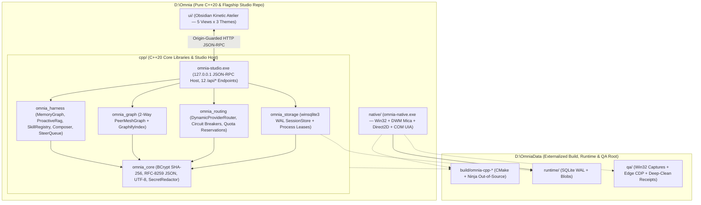

# Omnia — Collaborator Handoff Guide (for HTMusTC)

Welcome to **Omnia** (`https://github.com/khang-macphuc111107/omnia`). This document is the canonical technical onboarding and execution guide prepared from the full multi-host engineering history (**Codex**, **Antigravity App/IDE/CLI**, and **Claude CLI & Desktop**) so you can step directly into Flagship Studio UI/UX leadership, native **C++20** systems integration, and cross-host skill/prompt governance without losing a single product decision or architectural invariant.

---

## 1. Executive Vision & Full Native C++20 Architecture

Omnia is a **sovereign, native-first Windows 11 AI Agent, Peer-Mesh Harness, Flagship Studio Workbench, Embedded IDE, Sovereign Browser Host, and Multi-Segment Downloader** engineered for instant responsiveness, zero runtime bloat, and uninterrupted human-in-the-loop control.

### Full Native C++20 Migration (`0` Rust / `0` Cargo in `HEAD`)
Per the Wave 4 architectural mandate, Omnia's active product codebase is implemented in **100% Pure Modern C++20** (`MSVC 14.51` + `CMake 3.24+` + `Ninja` + `CTest` + first-party Windows 11 SDK `10.0.26100.0`: `winsqlite3`, `bcrypt`, `ws2_32`, `dwmapi`, `d2d1`, `dwrite`, `uiautomationcore`, `winhttp`).
- **`0` `.rs` and `0` `Cargo.*` files exist in `HEAD`**: all legacy Rust crates (`src-tauri/`) and legacy Vite/Tauri wrappers (`src/`, `scripts/`) have been retired from the working tree.
- **Zero-Loss Historical Preservation**: 100% of the verified Wave 1–3 Rust snapshot (`524/524` Cargo tests, commit `c3033728abe6f0a4906a796bf7652c84408356d7`) is permanently preserved on pushed Git tag `archive/pre-cpp-rust-snapshot-20261112` with `0` extra working-tree disk bytes.

### Two Native C++20 Executables
1. **`omnia-studio.exe` (`671.5 KB` Release, [cpp/](../../cpp/), `6/6` CTest suites)**:
   - Loopback C++20 JSON-RPC & static asset host (`127.0.0.1` `SO_EXCLUSIVEADDRUSE`, `12` `/api/*` endpoints, strict `403 Forbidden` cross-origin `Origin` & DNS-rebind `Host` guards) serving the **Flagship Studio UI ("Obsidian Kinetic Atelier", [ui/](../../ui/), [FLAGSHIP_STUDIO_UI_SPEC.md](../ui-direction/FLAGSHIP_STUDIO_UI_SPEC.md))** across `5` interactive views × `3` instant persisted Studio themes (`Obsidian`, `Alabaster`, `Blueprint`).
2. **`omnia-native.exe` (`283 KiB` Release, [native/](../../native/), `29/29` CTest cases + `7/7` Win32 QA workflows `90/90` cases `rc=0`)**:
   - Zero-dependency Windows 11 Per-Monitor DPI v2 desktop shell (`"Omnia — native C++20"`) featuring DWM Dark/Mica backdrop attributes, Direct2D + DirectWrite custom studio cards (`0` status-panel text clipping at `1220x820`), `winsqlite3` WAL session persistence with cooperative `(pid, start_filetime)` ownership leases, and server-side COM `WM_GETOBJECT` UI Automation (`IRawElementProviderSimple` + `IValueProvider` -> `uiaIssue: null`, plus thread-scoped `WH_CBT` `#32770` modal button `IInvokeProvider`).

### Seven Non-Negotiable Product Pillars
1. **Flagship Anti-AI-Slop Studio & Win32 UI (`PRODUCT-WORKSPACE`)**: Measurable typography/contrast/hit-target tokens (`87/87` WCAG 2.2 pairs `>= 5.12:1` across 3 themes), `0` purple-pink gradients, `0` `backdrop-filter` blur soup, `0` `9999px` pill badges, `0 px` horizontal overflow, and `0` clipped controls.
2. **Word-Grade Rich Composer + Dual-Mode Inline/Tray Attachments (`PRODUCT-COMPOSER`, `PRODUCT-ATTACHMENTS`)**: Formatting controls, zero-CDN LaTeX math AST rendering, `15` rendered Math/Physics/Chemistry templates (`∑ Math`, `ℏ Phys`, `⇌ Chem`), `Ctrl+V` modal choice (`inline-at-caret` vs `attachment tray` sharing one BCrypt SHA-256 `payload_id`, `Esc` zero-mutation cancel), and explicit `/Encrypt` / `.7z` unreadable provenance guards.
3. **Dynamic Multi-Provider / Account / Quota / Latency Router (`PRODUCT-ROUTING`)**: Routes across providers, account pools (`htmustc-proxy`), models, and reasoning efforts using capability/privacy/region/auth hard filters, explicit `QuotaState::{Known,Unknown,Stale,Contradictory}` (never coercing `Unknown` to `0`), `std::mutex` atomic quota reservations + interactive emergency reserve, EWMA/p95 latency, `Closed`/`Open`/`HalfOpen` circuit breakers, and secret-redacted receipts.
4. **Hierarchical Tree + Typed Graph Memory (`PRODUCT-MEMORY`)**: Multi-segment hierarchical namespaces (`Working` & `Durable` tiers) + typed graph edges with `EXTRACTED` / `INFERRED` / `AMBIGUOUS` provenance and cryptographic plaintext-free `ErasureReceipt`s.
5. **Proactive Bilingual Multi-Query Search & RAG (`PRODUCT-SEARCH`, `PRODUCT-KNOWLEDGE`)**: Proactively detects uncertain or time-sensitive English/Vietnamese queries without requiring keywords like `"search"` or `"latest"`, decomposes into multi-angle queries, and separates `cited_sources` from `unused_sources`.
6. **Zero-Focus-Steal Computer/Browser Use + Downloader + IDE (`PRODUCT-USE`)**: Off-focus `PrintWindow` capture (`native/qa-capture.ps1`), server-side UIA automation without physical cursor theft, C++20 IDE module explorer, and planned CDP browser + 128-segment HTTP/HLS/DASH integration.
7. **Bidirectional `PeerMeshGraph` & Additive Steer Queue (`PRODUCT-GRAPH`, `PRODUCT-GOALS`)**: Symmetric 2-way `Duplex` (`A <-> B`) agent links with `disjoint_paths` conflict guards and `GraphifyIndex` forward/reverse BFS, paired with `SteerQueue` (`ADDITIVE_INTAKE`, `token_budget = NULL` by default).

---

## 2. Clean-Root Architecture: `D:\Omnia` vs `D:\OmniaData`

A strict repository hygiene boundary governs all C++20 development ([GOAL.md](../workspace/GOAL.md), [DOD.md](../workspace/DOD.md)):

- **`D:\Omnia` (Tracked Product Repository ONLY)**:
  - Contains root [CMakeLists.txt](../../CMakeLists.txt) & [CMakePresets.json](../../CMakePresets.json), modular C++20 core & studio sources ([cpp/](../../cpp/)), Win32/Direct2D/UIA native shell ([native/](../../native/)), Flagship Studio UI ([ui/](../../ui/)), `13` curated cross-host skills ([.agents/skills/](../../.agents/skills/)), Antigravity multi-surface sync tool ([tools/agy-history-sync/](../../tools/agy-history-sync/)), and governance/UI/handoff docs (`docs/{workspace,ui-direction,handoff}/`).
  - **NEVER** emit `build/`, `out/`, `CMakeFiles/`, `CMakeCache.txt`, `compile_commands.json`, `*.obj`, `*.pdb`, `*.lib`, `*.exe`, SQLite runtime DBs, or QA screenshots inside `D:\Omnia`.
- **`D:\OmniaData` (Externalized Build, Runtime, QA, Research & History Root)**:
  - `D:\OmniaData\build\{omnia-cpp-core-release,omnia-cpp-core-debug,omnia-cpp-native-release,omnia-cpp-native-debug,omnia-full-release}` — all out-of-source CMake + Ninja build artifacts and CTest binaries.
  - `D:\OmniaData\runtime\` — `winsqlite3` WAL session databases, cooperative lease records, and SHA-256 content-addressed blobs.
  - `D:\OmniaData\qa\` — Win32 UIA/capture receipts, Edge CDP 45-state studio screenshots, independent audit ledgers, and `C:`/`D:` deep-clean receipts (`deep-clean-20261112/`). See `docs/workspace/DEEP_CLEAN_AUDIT_D_DRIVE.md`, `docs/workspace/DEEP_CLEAN_AUDIT_C_DRIVE.md`, and [CLEANUP_STATUS_20261112.md](../workspace/CLEANUP_STATUS_20261112.md) for full-volume reclamation audits.
  - `D:\OmniaData\research\` & `D:\OmniaData\exports\history\` — externalized URL qualification ledgers (`103 + 9` URLs, `100`-category catalog) and redacted multi-host chat history archives (`unified_agy_history.sqlite` `1,102` threads).



---

## 3. Honest Capability Matrix: Verified C++20 Baseline vs Next Sprints

Per Omnia's anti-overconfidence rule, every row distinguishes **verified C++20 / UI runtime behavior today** from **next integration milestones**:

| Subsystem | Location | Works Today (Verified in CTest, Edge CDP & Win32 QA) | Next Sprints for HTMusTC & Core Team |
|---|---|---|---|
| **Flagship Studio UI ("Obsidian Kinetic Atelier")** | [ui/](../../ui/) (`index.html`, `styles/*.css`, `app/*.js`), [FLAGSHIP_STUDIO_UI_SPEC.md](../ui-direction/FLAGSHIP_STUDIO_UI_SPEC.md) | `5` views (`Composer`, `Peer Mesh & Graphify`, `Router Lab`, `IDE & Proactive RAG`, `Memory Vault & Skills`) × `3` themes (`Obsidian`, `Alabaster`, `Blueprint`); zero-CDN LaTeX math AST + C++20 syntax highlighter; `8/8` `node --check` `rc=0`; `87/87` WCAG 2.2 pairs `>= 5.12:1`; `45`-state Headless Edge CDP (`0 px` overflow, `0` console errors) + live E2E against `omnia-studio.exe`. | Expand rich formatting ribbon (`tables`, `checklists`, drag-over-editor live insertion caret) and stream live token chunks from remote LLM providers. |
| **C++20 Studio Loopback Host (`omnia-studio.exe`)** | [cpp/apps/omnia_studio/main.cpp](../../cpp/apps/omnia_studio/main.cpp), [studio_server.cpp](../../cpp/src/studio/studio_server.cpp) | `671.5 KB` Release binary; `Winsock2` `127.0.0.1` (`SO_EXCLUSIVEADDRUSE`); serves `ui/` with `weakly_canonical` traversal containment; enforces `403` on cross-origin `Origin` or bad `Host`; implements all `12` `/api/*` endpoints; verified in `test_omnia_studio_http` (`6/6` CTest suites `100%` PASS). | Add `winhttp.lib` live SSE streaming adapters (`OpenAI`, `Anthropic`, `Gemini`, `htmustc-proxy`) and companion WebSocket push notifications. |
| **Win32 Native Desktop Shell (`omnia-native.exe`)** | [native/](../../native/) (`win32_shell.cpp`, `composer.cpp`, `uia_provider.cpp`, `session_panel.cpp`, `store.cpp`) | `283 KiB` Release binary; DWM Dark/Mica + Direct2D/DirectWrite cards (`0` status-panel clipping at `1220x820`); STEM buttons (`∑ Math`, `ℏ Phys`, `⇌ Chem`); server-side COM `IRawElementProviderSimple` + `IValueProvider` (`uiaIssue: null`) + `WH_CBT` `#32770` modal button `IInvokeProvider`; `29/29` CTest cases + `7/7` PowerShell Win32 QA suites (`90/90` cases `rc=0`). | Embed WebView2/Studio surface or custom DirectWrite rich document canvas inside `omnia-native` and connect live `omnia_routing` / `omnia_harness` dispatch. |
| **C++20 Graph, Routing, Storage & Harness (`cpp/**`)** | [cpp/include/omnia/](../../cpp/include/omnia/), [cpp/src/](../../cpp/src/), [cpp/tests/](../../cpp/tests/) | `PeerMeshGraph` (`Duplex` `A <-> B`, `disjoint_paths`, `max_hops`, `epoch`) + `GraphifyIndex` (`Forward`/`Reverse`/`Both` BFS, `AMBIGUOUS` quarantine); `DynamicProviderRouter` (`QuotaState`, circuit breakers, EWMA/p95, redacted receipts); `winsqlite3` WAL `SessionStore` + leases; `MemoryGraph` + `ErasureReceipt`; EN/VN `ProactiveRag`; `SkillRegistry` (`13` live skills); `ComposerModel` + `SteerQueue`. | Connect `ProactiveRag` to live web-search/local-index backends, port 128-segment `winhttp` Range/HLS/DASH downloader, and wire OS Credential Manager (`CredReadW`/`CredWriteW`) for live provider keys. |
| **Cross-Host Skills & History Sync (`13` Curated Skills + `agy-history-sync`)** | [.agents/skills/](../../.agents/skills/), [tools/agy-history-sync/](../../tools/agy-history-sync/) | `13` byte-identical skills across Omnia, Codex, and Antigravity (including [deep-cpp-native](../../.agents/skills/deep-cpp-native/SKILL.md) and [deep-proposal](../../.agents/skills/deep-proposal/SKILL.md)); `agy_history_sync.py` (`5/5` unit tests `OK`) unifying Antigravity App/IDE/CLI + Codex (`1,102` FTS5-indexed threads). | Maintain `100%` 4-way parity (`quick_validate.py` + `verify_pack.py`) whenever skills evolve. |

---

## 4. Daily C++20 Build, CTest & Live QA Workflow

### Prerequisites (Windows 11)
- **Visual Studio 2022/18 Build Tools (`vcvars64.bat`)**: MSVC `14.51+` (`cl.exe`), bundled `CMake 3.24+`, `CTest`, `Ninja`, and Windows 11 SDK (`10.0.26100.0`). Zero external vcpkg/conan downloads required.
- **Python 3.15** *(for `tools/agy-history-sync` and skill verifiers)* & **PowerShell 7 (`pwsh`)** *(for `native/qa-*.ps1`)*.
- **Out-of-Source Build Rule (MANDATORY)**: Always configure and build into `D:\OmniaData\build\...` via [CMakePresets.json](../../CMakePresets.json) or explicit `-B` paths—never inside `D:\Omnia`.

### Fast Build & Verification Commands

1. **C++20 Core Libraries & `omnia-studio.exe` (`6/6` CTest Suites)**:
   ```powershell
   cmd /c "`"C:\Program Files (x86)\Microsoft Visual Studio\18\BuildTools\VC\Auxiliary\Build\vcvars64.bat`" && cmake --preset omnia-cpp-core-release && cmake --build --preset omnia-cpp-core-release && ctest --preset omnia-cpp-core-release"
   ```

2. **Win32 Native Shell (`omnia-native.exe`, `29/29` CTest Cases) & Unified Workspace (`35/35` CTest Cases)**:
   ```powershell
   cmd /c "`"C:\Program Files (x86)\Microsoft Visual Studio\18\BuildTools\VC\Auxiliary\Build\vcvars64.bat`" && cmake -G Ninja -S D:\Omnia\native -B D:\OmniaData\build\omnia-cpp-native-release -DCMAKE_BUILD_TYPE=Release && cmake --build D:\OmniaData\build\omnia-cpp-native-release && ctest --test-dir D:\OmniaData\build\omnia-cpp-native-release --output-on-failure"

   cmd /c "`"C:\Program Files (x86)\Microsoft Visual Studio\18\BuildTools\VC\Auxiliary\Build\vcvars64.bat`" && cmake --preset omnia-full-release && cmake --build --preset omnia-full-release && ctest --test-dir D:\OmniaData\build\omnia-full-release --output-on-failure"
   ```

3. **Launch Live Flagship Studio (`omnia-studio.exe` + `ui/`)**:
   ```powershell
   D:\OmniaData\build\omnia-cpp-core-release\cpp\omnia-studio.exe --port 8787 --ui-root D:\Omnia\ui --skills-root D:\Omnia\.agents\skills
   # Open http://127.0.0.1:8787 in Edge/Chrome (binds strictly to 127.0.0.1)
   ```

4. **Run All `7/7` Native Win32 UIA, Paging, Modal Guard & Capture QA Suites (`90/90` Cases)**:
   All native QA scripts resolve `D:\OmniaData\build\omnia-cpp-native-{release,debug}\omnia-native.exe` automatically via [qa-paths.ps1](../../native/qa-paths.ps1) and write captures strictly under `D:\OmniaData\qa\`:
   ```powershell
   pwsh -NoProfile -File "D:\Omnia\native\qa-paths.tests.ps1"
   pwsh -NoProfile -File "D:\Omnia\native\qa-capture.tests.ps1"
   pwsh -NoProfile -File "D:\Omnia\native\qa-smoke.ps1"
   pwsh -NoProfile -File "D:\Omnia\native\qa-session.ps1"
   pwsh -NoProfile -File "D:\Omnia\native\qa-paging.ps1"
   pwsh -NoProfile -File "D:\Omnia\native\qa-guard.ps1"
   pwsh -NoProfile -File "D:\Omnia\native\qa-ownership.ps1"
   ```

5. **Repository Cleanliness & Whitespace Gate (Run Before Every Commit)**:
   ```powershell
   git -C "D:\Omnia" status --short
   git -C "D:\Omnia" diff --check
   ```

---

## 5. Priority Roadmap for HTMusTC

### Phase 1 — Studio Rich Editor Expansion & Native Host Integration (`Week 1`)
- Extend [ui/app/composer.js](../../ui/app/composer.js) and [composer_steer.cpp](../../cpp/src/harness/composer_steer.cpp) per [COMPOSER_REQUIREMENTS.md](../workspace/COMPOSER_REQUIREMENTS.md) with interactive Markdown table editing, checklist toggles, drag-over-editor live insertion caret, and multi-file folder ingestion manifests.
- Optionally host the Flagship Studio UI inside `omnia-native.exe` via WebView2 or synchronize shared `winsqlite3` WAL state between `omnia-native.exe` and `omnia-studio.exe`.

### Phase 2 — Live `winhttp` Provider Streaming & `htmustc-proxy` Telemetry (`Weeks 1–2`)
- Connect [dynamic_router.cpp](../../cpp/src/routing/dynamic_router.cpp) and [studio_server.cpp](../../cpp/src/studio/studio_server.cpp) to live HTTPS streaming (`winhttp.lib`) + OS Credential Manager (`CredReadW` / `CredWriteW`, zero plaintext keys on disk).
- Feed live `htmustc-proxy` and direct provider rate-limit headers into [ui/app/router-lab.js](../../ui/app/router-lab.js) (`Known` vs `Stale` vs `Unknown` quota meters, EWMA/p95 waterfalls, circuit-breaker auto-recovery).

### Phase 3 — Live Proactive RAG Connectors & AST Graphify Indexer (`Weeks 2–3`)
- Wire [proactive_rag.cpp](../../cpp/src/harness/proactive_rag.cpp) to live web search + local `winsqlite3` FTS5 document chunks, surfacing real-time `cited_sources`, `unused_sources`, and decomposed query traces in [ui/app/ide-explorer.js](../../ui/app/ide-explorer.js).
- Expand [graphify_index.cpp](../../cpp/src/graph/graphify_index.cpp) with an incremental C++20/Markdown/SQL symbol scanner feeding live repository graphs into [ui/app/peer-graph.js](../../ui/app/peer-graph.js).

### Phase 4 — C++20 Sovereign Browser, 128-Segment Downloader & Virtual Cursor (`Weeks 3–5`)
- Port the clean-room 128-segment HTTP `Range` + HLS/DASH downloader and CDP browser bridge to C++20 (`winhttp.lib` / `ws2_32.lib`) and expose focus-safe background window capture + Virtual Cursor overlay in `Mode::Browser` / `Mode::Chat`.

---

## 6. Essential Reading Map

| Document | Purpose |
|---|---|
| [USER_PROMPT_REQUIREMENTS_MATRIX.md](./USER_PROMPT_REQUIREMENTS_MATRIX.md) | Exhaustive, session-traceable matrix of every product, UI, C++20 migration, routing, memory, RAG, composer, deep-clean, and governance requirement across all hosts. |
| [BIDIRECTIONAL_AGENT_GRAPH_AND_GRAPHIFY.md](./BIDIRECTIONAL_AGENT_GRAPH_AND_GRAPHIFY.md) | C++20 2-way all-to-all `PeerMeshGraph` (`peer_mesh.hpp`) and `GraphifyIndex` (`graphify_index.hpp`) architecture + Studio canvas (`ui/app/peer-graph.js`). |
| [LESSONS_LEARNED_AND_ANTIPATTERNS.md](./LESSONS_LEARNED_AND_ANTIPATTERNS.md) | 15 provenance-backed engineering postmortems across Codex, Antigravity, and Claude—including CMake out-of-source builds, reparse-safe `robocopy /MIR /XJ /MT:32` cleanup, and 4-way skill parity. |
| [FLAGSHIP_STUDIO_UI_SPEC.md](../ui-direction/FLAGSHIP_STUDIO_UI_SPEC.md) & [DIRECTION_DECISION.md](../ui-direction/DIRECTION_DECISION.md) | "Obsidian Kinetic Atelier" visual specification, semantic token architecture, WCAG 2.2 contrast matrix, and anti-AI-slop invariants. |
| [GOAL.md](../workspace/GOAL.md) & [DOD.md](../workspace/DOD.md) | Canonical program goal tree and hard Definition of Done gates (`DOD-01`..`DOD-16`, including [Final audit rounds](../workspace/DOD.md#final-audit-rounds)). |
| [COMPOSER_REQUIREMENTS.md](../workspace/COMPOSER_REQUIREMENTS.md) & [DYNAMIC_ROUTING_REQUIREMENTS.md](../workspace/DYNAMIC_ROUTING_REQUIREMENTS.md) | Normative specifications for the rich Word-grade composer, dual-mode attachments, and dynamic multi-provider/quota/latency router. |
| [CHECKPOINT.md](../workspace/CHECKPOINT.md) & [DECISIONS.md](../workspace/DECISIONS.md) | Operational state ledger, architectural decision log, and pointers to `docs/workspace/DEEP_CLEAN_AUDIT_D_DRIVE.md` and `docs/workspace/DEEP_CLEAN_AUDIT_C_DRIVE.md`. |
