# Omnia — Collaborator Handoff Guide (for HTMusTC)

Welcome to **Omnia** (`https://github.com/khang-macphuc111107/omnia`). This document is the canonical technical onboarding and execution guide prepared from the full multi-host engineering history (**Codex**, **Antigravity App/IDE/CLI**, and **Claude CLI & Desktop**) so you can step directly into Flagship Studio UI/UX leadership, **Full Native Rust** systems integration, and cross-host skill/prompt governance without losing a single product decision or architectural invariant.

---

## 1. Executive Vision & Full Native Rust 17-Crate Architecture (`Steer #14..#15`)

Omnia is a **sovereign, native-first Windows 11 AI Agent, Peer-Mesh Harness, Flagship Studio Workbench, Embedded IDE, Sovereign Browser Host, Research Notebook, and Multi-Segment Downloader** engineered for instant responsiveness, zero runtime bloat, and uninterrupted human-in-the-loop control.

### Full Native Rust Migration (`0` C++ / CMake in Active Tree)
Under **Steer #14 -> Steer #15 (`Wave 5`, branch `omnia-sota-harness`)**, Omnia's active product codebase runs as a unified **17-crate Cargo workspace** ([`Cargo.toml`](../../Cargo.toml), [`Cargo.lock`](../../Cargo.lock), `edition = "2021"`, `windows-sys = "0.61"`, `winsqlite3` FFI, `0` `.cpp`/`.hpp`/`CMake*` files in active source) alongside Windows-native Python/Node tooling ([`tools/omnia-benchmark/`](../../tools/omnia-benchmark/), [`tools/omnia-gemini-extractor/`](../../tools/omnia-gemini-extractor/)):
- **Cargo Workspace & `serde` Discipline**: Root `Cargo.toml` defines shared workspace dependencies (`serde` with `derive`, `tokio`, `reqwest` `rustls-tls`, `tree-sitter`, `imara-diff`, `blake3`, `windows-sys`) compiled strictly out-of-source via `CARGO_TARGET_DIR=D:\OmniaData\build\omnia-rust-workspace`.
- **External Archival Preservation**: The superseded Wave 4 C++20/CMake snapshot (`55` files, `patch_bytes: 361065`) is backed up externally under `D:\OmniaData\backups\pre-full-rust-20261115\manifest.sha256.json`, and 100% of the pre-Wave-4 Rust/Tauri snapshot (`c3033728abe6f0a4906a796bf7652c84408356d7`) stays preserved on pushed Git tag `archive/pre-cpp-rust-snapshot-20261112`.

### Native Rust Executables & Subsystem Crates (`rust/`, `17` Crates)
1. **`omnia-studio.exe` ([rust/omnia-studio/](../../rust/omnia-studio/))**:
   - Loopback HTTP/JSON-RPC/SSE/WebSocket & static asset host (`127.0.0.1`, `Origin`/`Host` + traversal guards) wiring core crates (`omnia-winsqlite`, `omnia-core`, `omnia-storage`, `omnia-routing`, `omnia-graph`, `omnia-harness`, `omnia-connector-gateway`, `omnia-workspace-ops`, `omnia-agent`, `omnia-downloader`, `omnia-notebook`) to the **Flagship Studio UI ("Obsidian Kinetic Atelier", [ui/](../../ui/), [FLAGSHIP_STUDIO_UI_SPEC.md](../ui-direction/FLAGSHIP_STUDIO_UI_SPEC.md))** and Steer #15 `ui-v5/` (`Chat | IDE | Browser` OMP Desktop/CLI/`omp-omni` + Trae + VS Code fusion).
2. **`omnia.exe` ([rust/omnia-cli/](../../rust/omnia-cli/)) & `omnia-agent` ([rust/omnia-agent/](../../rust/omnia-agent/))**:
   - Ultra-lightweight `mimalloc` headless CLI + `ratatui` TUI (`omnia.exe`) powered by the `omnia-agent` SOTA coding-agent engine (`SuperHarnessManager`, `NativeSuperEngine`, ACP stdio/HTTP/WS server, Tree-sitter CST `WorkspaceGraphIndex`, `LazyLspManager`, Hashline/BlockDiff/`apply_patch` adaptive edits, `TurnCheckpointStore`, `PermissionsEngine`, `Sanitizer`, MCP/PTC/ConPTY/DAP/Hooks/PeerMesh swarm integration).
3. **`omnia-runtime.exe` ([rust/omnia-runtime/](../../rust/omnia-runtime/))**:
   - Provider/connector HTTP sidecar implementing AdGuard-tolerant loopback HTTP request-line parsing, multi-`Cookie` coalescing (`RFC 9110 §5.3` `; `, tested up to 15 headers), `30_000` ms default timeout, `NVIDIA` catalog bridge, and runtime skills index.
4. **`omnia-native.exe` + `omnia_qa_seed.exe` ([rust/omnia-native/](../../rust/omnia-native/), embedding [`native/app.manifest`](../../native/app.manifest))**:
   - Windows 11 Win32 + DWM Mica + Direct2D desktop shell (plus `--studio` WebView2 host under Steer #15), `winsqlite3` WAL persistence with cooperative `(pid, start_filetime)` leases, server-side COM UIA (`Edit` + `Document` + `WH_CBT` `#32770` modal button), `7` PowerShell 7 (`pwsh`) Win32 QA workflows (`native/qa-*.ps1`), and 125-row SQLite fixture seeder `omnia_qa_seed.exe`.
5. **Domain & Infrastructure Crates (`omnia-downloader`, `omnia-notebook`, `omnia-media-capture`, `omnia-remote-control`, `omnia-workspace-ops`, `omnia-harness`, `omnia-graph`, `omnia-routing`, `omnia-storage`, `omnia-core`, `omnia-winsqlite`)**:
   - Full Native Rust multi-stream HTTP/Google Drive/HLS/DASH downloader (`omnia-downloader`), Gemini Notebook & Atelier Research Studio engine (`omnia-notebook`), CDP browser + OBS v5 + DPI capture (`omnia-media-capture`), paired remote control (`omnia-remote-control`), canonical path containment (`omnia-workspace-ops`), `MemoryGraph`/`ProactiveRag`/`SkillRegistry`/`RichComposer`/`SteerQueue` (`omnia-harness`), `PeerMeshGraph`/`GraphifyIndex` (`omnia-graph`), and `DynamicProviderRouter` (`omnia-routing`).

### Seven Non-Negotiable Product Pillars
1. **Flagship Anti-AI-Slop Studio & Win32 UI (`PRODUCT-WORKSPACE`)**: Measurable typography/contrast/hit-target tokens (`87/87` WCAG 2.2 pairs `>= 5.12:1` across 3 themes), `0` purple-pink gradients, `0` `backdrop-filter` blur soup, `0` `9999px` pill badges, `0 px` horizontal overflow, and `0` clipped controls.
2. **Word-Grade Rich Composer + Dual-Mode Inline/Tray Attachments (`PRODUCT-COMPOSER`, `PRODUCT-ATTACHMENTS`)**: Formatting controls, zero-CDN LaTeX math AST rendering, `15` rendered Math/Physics/Chemistry templates (`∑ Math`, `ℏ Phys`, `⇌ Chem`), `Ctrl+V` modal choice (`inline-at-caret` vs `attachment tray` sharing one BCrypt SHA-256 `payload_id`, `Esc` zero-mutation cancel), and explicit `/Encrypt` / `.7z` unreadable provenance guards.
3. **Dynamic Multi-Provider / Account / Quota / Latency Router (`PRODUCT-ROUTING`)**: Routes across providers, account pools (`htmustc-proxy`), models, and reasoning efforts using capability/privacy/region/auth hard filters, explicit `QuotaState::{Known,Unknown,Stale,Contradictory}` (never coercing `Unknown` to `0`), `std::mutex` atomic quota reservations + interactive emergency reserve, EWMA/p95 latency, `Closed`/`Open`/`HalfOpen` circuit breakers, and secret-redacted receipts.
4. **Hierarchical Tree + Typed Graph Memory (`PRODUCT-MEMORY`)**: Multi-segment hierarchical namespaces (`Working` & `Durable` tiers) + typed graph edges with `EXTRACTED` / `INFERRED` / `AMBIGUOUS` provenance and cryptographic plaintext-free `ErasureReceipt`s.
5. **Proactive Bilingual Multi-Query Search & RAG (`PRODUCT-SEARCH`, `PRODUCT-KNOWLEDGE`)**: Proactively detects uncertain or time-sensitive English/Vietnamese queries without requiring keywords like `"search"` or `"latest"`, decomposes into multi-angle queries, and separates `cited_sources` from `unused_sources`.
6. **Zero-Focus-Steal Computer/Browser Use + Downloader + IDE (`PRODUCT-USE`)**: Off-focus `PrintWindow` capture (`native/qa-capture.ps1`), server-side UIA automation without physical cursor theft, C++20 IDE module explorer, and planned CDP browser + 128-segment HTTP/HLS/DASH integration.
7. **Bidirectional `PeerMeshGraph` & Additive Steer Queue (`PRODUCT-GRAPH`, `PRODUCT-GOALS`)**: Symmetric 2-way `Duplex` (`A <-> B`) agent links with `disjoint_paths` conflict guards and `GraphifyIndex` forward/reverse BFS, paired with `SteerQueue` (`ADDITIVE_INTAKE`, `token_budget = NULL` by default).

---

## 2. Clean-Root Architecture: `D:\Omnia` vs `D:\OmniaData`

A strict repository hygiene boundary governs all development ([GOAL.md](../workspace/GOAL.md), [DOD.md](../workspace/DOD.md)):

- **`D:\Omnia` (Tracked Product Repository ONLY)**:
  - Contains root [Cargo.toml](../../Cargo.toml) & [Cargo.lock](../../Cargo.lock), [`.gitattributes`](../../.gitattributes), `17` Rust crates ([rust/](../../rust/)), Win32 manifest & `7` `pwsh` QA workflows ([native/](../../native/)), Flagship Studio UI ([ui/](../../ui/)), packaging targets ([platform/](../../platform/)), `19` cross-host skills ([.agents/skills/](../../.agents/skills/) — `13` curated + `6` `kdense-*` projections), Python/Node tooling ([tools/](../../tools/), incl. `omnia-benchmark`, `omnia-gemini-extractor`, `agy-history-sync`, `omnia-consolidated-audit`, `omnia-skill-parity`), and governance/UI/architecture/handoff docs (`docs/{workspace,ui-direction,architecture,handoff}/`).
  - **NEVER** emit `target/`, `build/`, `out/`, `*.exe`, `*.pdb`, `__pycache__/`, `Roaming/`, SQLite runtime DBs, or QA screenshots inside `D:\Omnia`.
- **`D:\OmniaData` (Externalized Build, Runtime, QA, Backup, Research & History Root)**:
  - `D:\OmniaData\build\omnia-rust-workspace` (`omnia-rust-native-{release,debug}`, `ui-dist`) — all out-of-source Cargo target directories, UI dist builds, and staged test binaries.
  - `D:\OmniaData\backups\pre-full-rust-20261115\` & `D:\OmniaData\quarantine\roaming-20261124\` — SHA-256 backup archive of the `55` superseded Wave 4 C++20/CMake files and quarantined legacy `Roaming/` test cache.
  - `D:\OmniaData\runtime\` — `winsqlite3` WAL session databases, cooperative lease records, and SHA-256 content-addressed blobs.
  - `D:\OmniaData\qa\` — Win32 UIA/capture receipts, Edge/Playwright CDP captures, independent audit ledgers, and `C:`/`D:` deep-clean receipts (`deep-clean-20261112/`). See `docs/workspace/DEEP_CLEAN_AUDIT_D_DRIVE.md`, `docs/workspace/DEEP_CLEAN_AUDIT_C_DRIVE.md`, and [CLEANUP_STATUS_20261112.md](../workspace/CLEANUP_STATUS_20261112.md).
  - `D:\OmniaData\research\` & `D:\OmniaData\exports\history\` — externalized URL qualification ledgers (`103 + 9` URLs, `100`-category catalog) and redacted multi-host chat history archives (`unified_agy_history.sqlite` `1,102` threads).

```mermaid
flowchart TB
    subgraph Repo["D:\Omnia (Full Native Rust & Flagship Studio Repo)"]
        StudioUI["ui/ & ui-v5/ (OMP + Trae + VS Code Studio)"]
        CLI["rust/omnia-cli/ (omnia.exe Headless + ratatui TUI)"]
        Native["rust/omnia-native/ + native/ (Win32 + DWM + COM UIA + --studio + pwsh QA)"]
        Runtime["rust/omnia-runtime/ + omnia-connector-gateway/ (HTTP/SSE + AdGuard Proxy)"]
        Tools["tools/ (omnia-benchmark, omnia-gemini-extractor, parity, audit)"]
        subgraph RustCore["rust/ Core, Agent & Studio Workspace (17 Cargo Crates)"]
            StudioSrv["omnia-studio (127.0.0.1 HTTP/SSE/WS Host)"]
            Agent["omnia-agent (SuperHarnessManager, ACP, MCP, PTC, LSP/AST)"]
            Notebook["omnia-notebook + omnia-downloader (Atelier + OmniDrive)"]
            Harness["omnia-harness (MemoryGraph, ProactiveRag, SkillRegistry, Composer, SteerQueue)"]
            Graph["omnia-graph (2-Way PeerMeshGraph + GraphifyIndex)"]
            Routing["omnia-routing (DynamicProviderRouter, Circuit Breakers, Quota Reservations)"]
            Storage["omnia-storage + omnia-winsqlite (WAL SessionStore + Process Leases)"]
            Core["omnia-core (JSON, SHA-256, UTF-8, SecretRedactor, CredMan)"]
        end
    end

    subgraph Ext["D:\OmniaData (Externalized Build, Runtime, Backup & QA Root)"]
        BuildDir["build/omnia-rust-workspace + build/ui-dist"]
        Backup["backups/pre-full-rust-20261115/ & quarantine/roaming-20261124/"]
        RuntimeData["runtime/ (SQLite WAL + Blobs)"]
        QA["qa/ (Win32 Captures + Playwright CDP + Benchmarks + Audit Receipts)"]
    end

    StudioUI <-->|"Origin-Guarded HTTP/SSE/WS"| StudioSrv
    StudioSrv --> Agent
    StudioSrv --> Notebook
    StudioSrv --> Runtime
    StudioSrv --> Harness
    StudioSrv --> Graph
    StudioSrv --> Routing
    StudioSrv --> Storage
    CLI --> Agent
    Agent --> Core
    Notebook --> Core
    Harness --> Core
    Graph --> Core
    Routing --> Core
    Storage --> Core
    Native --> RuntimeData
    Storage -.-> RuntimeData
    RustCore -.-> BuildDir
    Native -.-> BuildDir
    Native -.-> QA
```



---

## 3. Honest Capability Matrix: Historical Wave 4 vs Active Full Native Rust & Next Gates

Per Omnia's anti-overconfidence rule, every row distinguishes **migrated Wave 5 Rust modules & verified parity checks** from **remaining Wave 2/3 verification & product gates**:

| Subsystem | Location | Wave 5 Full Native Rust & Parity Surface | Next Verification & Integration Gates |
|---|---|---|---|
| **Flagship Studio UI ("Obsidian Kinetic Atelier")** | [ui/](../../ui/) (`index.html`, `styles/*.css`, `app/*.js`), [FLAGSHIP_STUDIO_UI_SPEC.md](../ui-direction/FLAGSHIP_STUDIO_UI_SPEC.md) | `5` views × `3` themes (`Obsidian`, `Alabaster`, `Blueprint`); Rust syntax highlighter (`api.js`), short-probe (`2400–3200 ms`) vs `65,000 ms` chat timeout clamping, `connectionMode = LIVE_RUST`, zero-CDN math AST, `87/87` WCAG 2.2 tokens (`>= 5.12:1`). | Complete live Wave 2/3 Edge `/browser` CDP QA (`0 px` overflow, `0` console errors) against Rust `omnia-studio.exe` + expanded formatting ribbon. |
| **Rust Studio Host (`omnia-studio.exe`) & Sidecar (`omnia-runtime.exe`)** | [rust/omnia-studio/](../../rust/omnia-studio/), [rust/omnia-runtime/](../../rust/omnia-runtime/), [rust/omnia-connector-gateway/](../../rust/omnia-connector-gateway/) | `omnia-runtime` AdGuard RFC 9110 multi-`Cookie` coalescing + `30_000 ms` proxy budget; `omnia-studio` loopback host structure serving `ui/` and `/api/*` endpoints. | Finish Wave 2 `omnia-studio` wiring + run unified `--workspace --offline --locked` build/test + live provider HTTP/SSE streaming & OS Credential Manager keys. |
| **Win32 Native Desktop Shell (`omnia-native.exe`)** | [rust/omnia-native/](../../rust/omnia-native/), [native/](../../native/) (`app.manifest`, `qa-*.ps1`) | Win32 shell crate + 125-row `omnia_qa_seed.exe` + `7` PowerShell 7 (`pwsh`) QA workflows enforcing DPI `8192` clamp/`finally` restore & `Edit`/`Document` UIA split. | Finish Wave 2 `omnia-native` implementation + run `7/7` `pwsh` QA suites against compiled Rust binaries + physical Vietnamese IME/Narrator matrix. |
| **Rust Core, Graph, Routing, Storage, Workspace, Media & Remote** | [rust/omnia-{winsqlite,core,storage,routing,graph,harness,workspace-ops,media-capture,remote-control}/](../../rust/) | `PeerMeshGraph` (`Duplex` `A <-> B`, `disjoint_paths`), `GraphifyIndex`, `DynamicProviderRouter`, `winsqlite3` WAL `SessionStore` + leases, `MemoryGraph` + `ErasureReceipt`, EN/VN `ProactiveRag`, `ComposerModel`/`RichComposer`, `SteerQueue`, `path_guard`, `browser_cdp`/`obs_v5`, and `remote-control`. | Pass unified `cargo check/clippy/test/build --workspace --offline --locked`, connect live web-search/CDP/OBS/remote UI workflows, and pass `3` frozen cleanroom audits. |
| **Cross-Host Skills & History Sync (`19` Repo Skills + `tools/`)** | [.agents/skills/](../../.agents/skills/), [tools/agy-history-sync/](../../tools/agy-history-sync/), [tools/omnia-consolidated-audit/](../../tools/omnia-consolidated-audit/) | **`19/19` pure-`LF` skills synced 3-way with `cross_host_drift_count: 0`** (`13` curated + `6` `kdense-*` projections via `validate_skills.py --strict-all-skills`); Python sync & audit suites (`python -B`). | Maintain `0` cross-host drift, `0` trailing-whitespace/CRLF/BOM findings, and `0` secrets across `audit.py --secret-scope all --strict --strict-scope full`. |

---

## 4. Daily Full Native Rust Build, Test & Live `pwsh` QA Workflow

### Prerequisites (Windows 11)
- **Rust Toolchain (`rustc` / `cargo`, edition `2021`, offline Cargo lock)** + **Windows 11 SDK** (`winsqlite3`, user32/d2d1/dwrite/uiautomationcore/dwmapi).
- **Python 3** *(always run `python -B` so zero `__pycache__` is emitted)* & **PowerShell 7 (`pwsh`)** *(mandatory for `native/qa-*.ps1`)*.
- **Out-of-Source Build Rule (MANDATORY)**: Always set `$env:CARGO_TARGET_DIR = 'D:\OmniaData\build\omnia-rust-workspace'`—never build into `D:\Omnia\target`.

### Fast Build & Verification Commands

1. **Unified 17-Crate Cargo Workspace (`--offline --locked`)**:
   ```powershell
   $env:CARGO_TARGET_DIR = 'D:\OmniaData\build\omnia-rust-workspace'
   cargo check --workspace --offline --locked
   cargo clippy --workspace --offline --locked
   cargo test --workspace --offline --locked
   cargo build --workspace --release --offline --locked
   ```

2. **Launch Omnia CLI/TUI (`omnia.exe`), Flagship Studio (`omnia-studio.exe`), Runtime Sidecar & Native Shell**:
   ```powershell
   D:\OmniaData\build\omnia-rust-workspace\release\omnia.exe --version
   D:\OmniaData\build\omnia-rust-workspace\release\omnia-studio.exe
   D:\OmniaData\build\omnia-rust-workspace\release\omnia-runtime.exe
   D:\OmniaData\build\omnia-rust-workspace\release\omnia-native.exe
   # Open http://127.0.0.1:8787 in Edge/Chrome (binds strictly to 127.0.0.1)
   ```

3. **Run All `7/7` Native Win32 UIA, Paging, Modal Guard & Capture QA Suites (`pwsh`)**:
   All native QA scripts must run via **PowerShell 7 (`pwsh`)**, resolve binaries via [qa-paths.ps1](../../native/qa-paths.ps1) (external `D:\OmniaData\build\omnia-rust-native-{release,debug}` staging), and write captures strictly under `D:\OmniaData\qa\`:
   ```powershell
   pwsh -NoProfile -File "D:\Omnia\native\qa-paths.tests.ps1"
   pwsh -NoProfile -File "D:\Omnia\native\qa-capture.tests.ps1"
   pwsh -NoProfile -File "D:\Omnia\native\qa-smoke.ps1"
   pwsh -NoProfile -File "D:\Omnia\native\qa-session.ps1"
   pwsh -NoProfile -File "D:\Omnia\native\qa-paging.ps1"
   pwsh -NoProfile -File "D:\Omnia\native\qa-guard.ps1"
   pwsh -NoProfile -File "D:\Omnia\native\qa-ownership.ps1"
   ```

4. **Skill Parity, Python Suites, Audit, JS Syntax & Repository Cleanliness Gate**:
   ```powershell
   python -B "D:\Omnia\tools\omnia-skill-parity\validate_skills.py" --strict-all-skills
   python -B -m unittest discover -s "D:\Omnia\tools\omnia-benchmark" -p "test_*.py"
   python -B -m unittest discover -s "D:\Omnia\tools\omnia-gemini-extractor" -p "test_*.py"
   python -B "D:\Omnia\tools\omnia-consolidated-audit\audit.py" --secret-scope all --strict --strict-scope full
   node --check D:\Omnia\ui\app\*.js
   git -C "D:\Omnia" diff --check
   ```

---

## 5. Priority Roadmap for HTMusTC

### Phase 1 — Wave 2/3 Parity Closure, Rich Composer Ribbon & Live Browser CDP
- Complete live `/browser` Edge CDP QA of [ui/app/composer.js](../../ui/app/composer.js), [peer-graph.js](../../ui/app/peer-graph.js), [router-lab.js](../../ui/app/router-lab.js), [ide-explorer.js](../../ui/app/ide-explorer.js), and [memory-vault.js](../../ui/app/memory-vault.js) wired to Rust `omnia-studio.exe`, then expand [COMPOSER_REQUIREMENTS.md](../workspace/COMPOSER_REQUIREMENTS.md) table editing, checklist toggles, and drag-over-editor live insertion caret.

### Phase 2 — Live HTTPS Provider Streaming & `htmustc-proxy` Telemetry
- Connect [omnia-routing](../../rust/omnia-routing/), [omnia-connector-gateway](../../rust/omnia-connector-gateway/), and [omnia-runtime](../../rust/omnia-runtime/) to live authenticated HTTPS/SSE streaming + Windows Credential Manager (`CredReadW` / `CredWriteW`, zero plaintext keys on disk), feeding live quota meters (`Known` vs `Stale` vs `Unknown`) into [ui/app/router-lab.js](../../ui/app/router-lab.js).

### Phase 3 — Live Proactive RAG, Workspace Ops & AST Graphify Indexer
- Connect [proactive_rag.rs](../../rust/omnia-harness/src/proactive_rag.rs), [omnia-workspace-ops](../../rust/omnia-workspace-ops/), and [graphify_index.rs](../../rust/omnia-graph/src/graphify_index.rs) to live search + FTS5 document chunks + Rust/JS AST symbols feeding [ui/app/ide-explorer.js](../../ui/app/ide-explorer.js) and [ui/app/peer-graph.js](../../ui/app/peer-graph.js).

### Phase 4 — Browser CDP, OBS Capture, Remote Control & Cross-Platform Packaging
- Wire [omnia-media-capture](../../rust/omnia-media-capture/), [omnia-remote-control](../../rust/omnia-remote-control/), and [platform/](../../platform/) packaging runners with reproducible cleanroom receipts.

---

## 6. Essential Reading Map

| Document | Purpose |
|---|---|
| [USER_PROMPT_REQUIREMENTS_MATRIX.md](./USER_PROMPT_REQUIREMENTS_MATRIX.md) | Exhaustive, session-traceable matrix of every product, UI, Steer #14..#15 Full Native Rust 17-crate & Omnia v5 requirement across all hosts. |
| [BIDIRECTIONAL_AGENT_GRAPH_AND_GRAPHIFY.md](./BIDIRECTIONAL_AGENT_GRAPH_AND_GRAPHIFY.md) | Rust 2-way all-to-all `PeerMeshGraph` (`peer_mesh.rs`) and `GraphifyIndex` (`graphify_index.rs`) architecture + Studio canvas (`ui/app/peer-graph.js`). |
| [LESSONS_LEARNED_AND_ANTIPATTERNS.md](./LESSONS_LEARNED_AND_ANTIPATTERNS.md) | Engineering postmortems across Codex, Antigravity, and Claude—including Cargo out-of-source `CARGO_TARGET_DIR`, `pwsh` QA, `.gitattributes` LF, AdGuard multi-`Cookie`, reparse-safe cleanup, zero-secret test fixtures, and `19`-skill parity. |
| [FLAGSHIP_STUDIO_UI_SPEC.md](../ui-direction/FLAGSHIP_STUDIO_UI_SPEC.md) & [DIRECTION_DECISION.md](../ui-direction/DIRECTION_DECISION.md) | "Obsidian Kinetic Atelier" visual specification, semantic token architecture, WCAG 2.2 contrast matrix, and anti-AI-slop invariants. |
| [GOAL.md](../workspace/GOAL.md) & [DOD.md](../workspace/DOD.md) | Canonical program goal tree and hard Definition of Done gates (`DOD-01`..`DOD-16`, including [Final audit rounds](../workspace/DOD.md#final-audit-rounds)). |
| [COMPOSER_REQUIREMENTS.md](../workspace/COMPOSER_REQUIREMENTS.md) & [DYNAMIC_ROUTING_REQUIREMENTS.md](../workspace/DYNAMIC_ROUTING_REQUIREMENTS.md) | Normative specifications for the rich Word-grade composer, dual-mode attachments, and dynamic multi-provider/quota/latency router. |
| [CHECKPOINT.md](../workspace/CHECKPOINT.md) & [DECISIONS.md](../workspace/DECISIONS.md) | Operational state ledger, architectural decision log (`Steer #14..#15` Wave 5 ADR), and pointers to `docs/workspace/DEEP_CLEAN_AUDIT_D_DRIVE.md` and `docs/workspace/DEEP_CLEAN_AUDIT_C_DRIVE.md`. |
