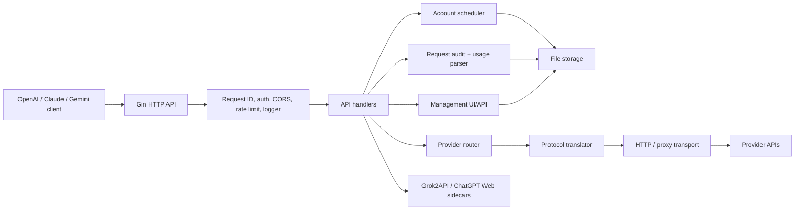
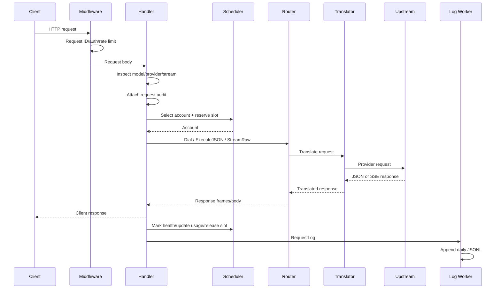

# HTMusTC Proxy — Software Requirements Specification

**Document status:** Baseline implementation specification<br>
**Version:** 1.0<br>
**Last updated:** 2026-08-21<br>
**System:** HTMusTC Proxy

## 1. Purpose

HTMusTC Proxy is a Go-based, OpenAI-compatible multi-provider AI gateway. It accepts requests from OpenAI SDKs and compatible clients, normalizes and translates protocol payloads, selects an available account, forwards the request to the provider, translates the response back, and records operational telemetry.

This document describes the implemented system contract, logical structure, request lifecycle, data model, operational requirements, and known boundaries. It is the reference for future optimization and feature work.

## 2. Scope

### 2.1 In scope

- OpenAI-compatible APIs under `/v1/*`.
- Claude-compatible messages API under `/v1/messages`.
- OpenAI Responses-compatible APIs under `/v1/responses` and `/backend-api/codex/responses`.
- Gemini-compatible APIs under `/v1beta/models/*`.
- Chat completions, Responses, embeddings, image generation/editing, audio speech, and transcription routes.
- Multi-account provider routing with priority, weight, round-robin variants, affinity, concurrency limits, cooldown, and failover.
- Provider protocol translation through the CLIProxyAPI translator dependency.
- API key, management authentication, CORS, request ID, rate limiting, and structured HTTP logging.
- File-backed accounts, settings, proxy pools, plugins, and request logs.
- Embedded Grok2API and ChatGPT Web sidecars when enabled.
- Management UI and management API.

### 2.2 Out of scope

- General-purpose response caching of model output. Such caching is unsafe unless the cache key includes all semantic request inputs, credentials, tools, schemas, conversation state, and policy context.
- Provider-specific billing correctness beyond the usage information returned by the provider.
- Guaranteed latency independent of upstream provider, network, proxy, account health, or model queueing.
- Distributed coordination between multiple HTMusTC Proxy processes using file storage.

## 3. System Context



## 4. Architectural Principles

1. **Thin entrypoint:** `cmd/htmustc-proxy` only starts the application composition root.
2. **Explicit composition:** `internal/app` loads configuration, initializes logging/storage/scheduling, starts the HTTP server, and owns shutdown.
3. **Protocol separation:** handlers deal with HTTP contracts; `internal/proxy` deals with provider routing, translation, streaming, and response normalization.
4. **Canonical translation:** inbound and upstream formats are represented explicitly and translated through the CLIProxyAPI translator registry rather than ad-hoc per-handler conversions.
5. **Failover before response commitment:** streaming failover is allowed only until the first response frame is committed to the client.
6. **Best-effort telemetry:** request logging must not block or corrupt the model response; telemetry persistence errors are logged separately.
7. **No secrets in logs:** credentials, authorization headers, and raw sensitive content must not be emitted by normal operational logging.
8. **File storage is single-process storage:** it is simple and durable for one process, not a distributed database.

## 5. Repository Structure

| Path | Responsibility |
|---|---|
| `cmd/htmustc-proxy` | Binary entrypoint. |
| `internal/app` | Configuration, logging, storage, scheduler, sidecar, and server lifecycle. |
| `internal/config` | YAML schema, defaults, path resolution, and validation. |
| `internal/api` | HTTP server, route registration, middleware, handlers, session, and dashboard. |
| `internal/api/handler` | OpenAI/Claude/Gemini endpoints, management endpoints, and sidecar forwarding. |
| `internal/api/middleware` | Request ID, structured HTTP log, CORS, rate limit, API key, and management auth. |
| `internal/proxy` | Account scheduling, provider routing, protocol translation, HTTP transport, SSE, tools, and usage parsing helpers. |
| `internal/providers` | Built-in provider registry, model catalog, transport, auth, feature, and usage definitions. |
| `internal/storage` | Storage interface, JSON account/settings/proxy/plugin files, and append-only request logs. |
| `internal/codexweb` | ChatGPT Web sidecar integration and forwarding. |
| `internal/grok2api` | Embedded Grok2API lifecycle, forwarding, and account integration. |
| `internal/oauthimport` | Importers for supported local OAuth/session stores. |
| `internal/obs/ringlog` | In-memory management-console log ring. |
| `configs` | Example configuration. |
| `docs` | Architecture, provider notes, and this SRS. |
| `scripts` | Smoke tests and provider registry conversion helpers. |
| `third_party` | Runtime source/assets used by embedded sidecars. |

## 6. Runtime Components

### 6.1 Application lifecycle

1. Resolve configuration in this order: explicit `-config`, `HTMUSTC_CONFIG`, `./config.yaml`, `./configs/config.yaml`.
2. Load YAML and apply defaults.
3. Configure zerolog output and the management ring log.
4. Validate configuration.
5. Initialize file storage and its asynchronous request-log worker.
6. Initialize the shared account manager and routing policy.
7. Construct the Gin HTTP server and handlers.
8. Optionally prepare and start Grok2API and ChatGPT Web sidecars.
9. Listen on the configured HTTP address.
10. On SIGINT/SIGTERM, stop accepting requests, gracefully shut down HTTP, and close storage.

### 6.2 HTTP middleware order

The server applies middleware in this order:

1. Gin recovery.
2. Request ID generation or propagation through `X-Request-ID`.
3. Structured HTTP request logging.
4. CORS headers and preflight handling.
5. Global rate limiting, excluding health and management paths as configured.
6. Route-specific API key or management authentication.

### 6.3 Request audit context

Inference handlers attach a request audit object to the request context. It collects:

- Request ID, inbound format, stream flag, start time, request bytes.
- First response frame time and response bytes.
- Cache read/write token counts and cache-hit status.
- Reasoning effort and reasoning token count.
- Tool schema count, actual output tool-call count, schema presence, and XML presence.
- Failover/token-refresh retry count.

The audit object is mutable only within the lifetime of the request handler and is converted into a `storage.RequestLog` record at terminal success, error, or client disconnect.

## 7. Functional Requirements

### FR-01 — Request acceptance

The gateway shall accept JSON requests on supported API routes and reject empty, malformed, or model-less inference requests with an OpenAI-compatible error object.

### FR-02 — Request inspection

The gateway shall inspect `model`, `provider`, and `stream` with a lightweight JSON path pass before full request decoding. It shall preserve the original body for translation and retries.

### FR-03 — Protocol normalization

The gateway shall detect a Responses-shaped payload posted to the chat-completions endpoint and normalize it to the canonical inbound representation before routing.

### FR-04 — Provider selection

If `provider` is present, the gateway shall use it. Otherwise, it shall resolve a provider using the model registry and provider-prefix heuristics.

### FR-05 — Account scheduling

The scheduler shall exclude disabled, quota-exhausted, unhealthy, cooldown-blocked, and concurrency-saturated accounts. It shall support priority tiers and the configured strategy:

- Smooth weighted round robin.
- Round robin with sticky behavior.
- Weighted random.
- Fill-first where enabled by the runtime policy.

### FR-06 — Conversation affinity

When enabled, a conversation key derived from session/thread/conversation/prompt-cache/user fields shall prefer the previously successful account, unless the selected strategy explicitly overrides affinity.

### FR-07 — OAuth retry

The gateway shall refresh an expiring OAuth token before a call when applicable. On an authentication failure, it shall force-refresh once and retry the request once with the refreshed credential.

### FR-08 — Protocol translation

The gateway shall translate request and response payloads between OpenAI, OpenAI Responses, Claude, Gemini, Codex, and provider-specific transport formats using the translator registry.

### FR-09 — Upstream transport

The gateway shall reuse HTTP connections, support configured HTTP/HTTPS/SOCKS proxy pools, honor strict proxy mode, and fall back to direct transport only when the pool is non-strict and the request body is replayable.

### FR-10 — Non-stream response

The gateway shall read and validate a bounded upstream JSON response, translate it to the inbound format, detect empty responses, and return an appropriate HTTP status.

### FR-11 — Streaming response

The gateway shall read SSE/data frames incrementally, translate each frame, flush frames promptly, emit the expected terminal marker, and avoid failover after the first client-visible frame.

### FR-12 — Usage and cache accounting

The gateway shall extract input tokens, output tokens, cache-read tokens, cache-write tokens, and reasoning tokens from supported provider field variants. Missing usage data shall be represented as zero, not inferred from text length.

### FR-13 — Tool/schema/XML accounting

The gateway shall record whether tools and schemas were supplied, the number of supplied tool definitions, the number of output function calls when available, and whether XML-like content was present without storing secrets or full content in the normal request log.

### FR-14 — Account health

The gateway shall classify upstream failures into authentication, rate-limit/quota, server/timeout, and request-shaped failures. It shall apply the configured cooldown policy and avoid punishing invalid client requests where possible.

### FR-15 — Request logging

Each inference terminal path shall create a request log containing at least:

- Request ID, account, provider, endpoint, model, inbound/upstream formats.
- HTTP status, total latency, stream flag, TTFB when available.
- Input/output/cache token counts and reasoning metadata.
- Tool/schema/XML metadata.
- Retry count, request/response byte counts, timestamp, and sanitized error message.

### FR-16 — Management

The management surface shall expose account CRUD, account health reset, provider/model catalog, routing policy, settings, proxy pools, plugins, request logs, usage analytics, health endpoints, and the embedded sidecar controls implemented by the handlers.

## 8. Request Lifecycle



### 8.1 Non-stream path

1. Read body.
2. Inspect routing hints and validate model.
3. Normalize inbound protocol if needed.
4. Select and reserve an account.
5. Execute request with OAuth retry and account failover.
6. Read bounded response or aggregate forced SSE.
7. Translate response to inbound format.
8. Update usage/health and append telemetry.
9. Release the account slot.

### 8.2 Stream path

1. Read body and inspect routing hints.
2. Select and reserve an account.
3. Dial upstream and start the frame reader.
4. Retry another account only before the first valid frame is committed.
5. Set SSE headers, write frames, flush, and update rolling usage metadata.
6. On completion, emit `[DONE]` for OpenAI-compatible inbound streams where required.
7. Mark account health, persist telemetry, and release the slot.

## 9. Data Model

### 9.1 Account

Accounts are JSON files under the configured storage directory. An account includes:

- Stable ID, provider, type, credentials, status.
- Quota and rate-limit counters.
- Weight, priority, concurrency override.
- Cooldown deadline and last error.
- Optional proxy-pool binding.
- Created/updated timestamps.

Credentials are opaque values to the scheduler and router. They may contain API keys, OAuth tokens, transport selection, region, deployment, resource, or provider-specific fields.

### 9.2 RequestLog

Request logs are append-only JSONL files named `requests-YYYY-MM-DD.jsonl`. Writes are queued through the storage worker where possible. The management API reads and sorts logs newest-first.

### 9.3 Settings, plugins, and proxy pools

These are JSON or text files under independent storage directories. Updates are serialized through the file-storage lock.

## 10. API Requirements

### 10.1 Public endpoints

| Endpoint | Purpose |
|---|---|
| `/health` | Human-readable health response. |
| `/healthz` | Liveness probe, including `HEAD`. |
| `/ping` | Lightweight ping. |
| `/v1/chat/completions` | OpenAI chat completions and compatible bodies. |
| `/v1/completions` | Legacy completion compatibility. |
| `/v1/responses` | OpenAI Responses compatibility. |
| `/backend-api/codex/responses` | Codex Responses alias. |
| `/v1/messages` | Claude messages compatibility. |
| `/v1beta/models/*action` | Gemini compatibility. |
| `/v1/models` | Aggregated available model catalog. |
| `/v1/embeddings` | Embedding requests. |
| `/v1/images/*` | Image generation/editing. |
| `/v1/audio/*` | Speech and transcription. |

### 10.2 Management endpoints

Management routes are under `/api/management/*` and are protected by the configured login/session and/or management secret. The dashboard is served at `/management`.

### 10.3 Error contract

Inference errors should use:

```json
{
  "error": {
    "message": "provider request failed: ...",
    "type": "api_error"
  }
}
```

Invalid client payloads use `invalid_request_error`; unavailable or busy account pools use `service_unavailable`; upstream status codes are preserved when safely extractable.

## 11. Configuration Requirements

The effective configuration is the merged YAML plus defaults from `internal/config`. Important controls include:

- `server.address`, read/header/write/idle timeouts, max headers, storage path, API keys.
- `logging.level`, format, and output.
- CORS allowed origins/methods/headers.
- Plugin enablement and directory.
- Rate-limit window and burst.
- Routing strategy, cooldowns, concurrency, busy retry, and jitter.
- Embedded Grok2API and ChatGPT Web enablement/listen addresses.
- Management login/password/secret.

The production deployment should copy `configs/config.example.yaml` to `config.yaml`, set non-empty management credentials, restrict CORS, and avoid committing account credentials.

## 12. Non-Functional Requirements

### 12.1 Performance

- Avoid repeated parsing of the same request body on the routing hot path.
- Reuse upstream HTTP connections.
- Do not block response streaming on disk telemetry writes.
- Keep request logs compact and metadata-oriented by default.
- Bound response/body buffers to prevent unbounded memory growth.
- Never introduce unsafe response caching merely to improve apparent cache-hit rate.

### 12.2 Reliability

- Graceful shutdown shall allow in-flight requests to finish within the configured shutdown budget.
- A failed account shall not prevent healthy accounts from serving requests.
- A telemetry persistence error shall not replace a successful model response.
- Streaming must stop promptly when the client context is canceled.

### 12.3 Security

- Do not log API keys, OAuth tokens, cookies, or management secrets.
- Store account files with restrictive permissions.
- Use management authentication outside trusted local development.
- Validate proxy URLs and prevent unsafe shell interpolation.
- Keep embedded sidecars on loopback unless external exposure is explicitly required.

### 12.4 Operability

- Include `X-Request-ID` in responses and structured logs.
- Expose `/health`, `/healthz`, and `/ping` for probes.
- Provide management request logs and usage analytics.
- Preserve enough request metadata to diagnose cache, reasoning, tool, schema, retry, and failover behavior.

## 13. Failure and Recovery Semantics

| Failure | Account action | Client behavior |
|---|---|---|
| Invalid request | Do not cooldown account | `400 invalid_request_error`. |
| 401/403 credential failure | Mark unhealthy until manual reset | Retry refresh once, then failover or error. |
| 429/quota | Apply rate-limit cooldown | Failover, preserve status where possible. |
| 5xx/timeout | Apply server-error cooldown | Failover before stream commitment. |
| All accounts busy | No health mutation | `503` with `Retry-After` when applicable. |
| Client disconnect | Release slot | Stop upstream work through context cancellation. |
| Empty upstream response | Treat as execution failure | Failover where still possible. |

## 14. Testing Requirements

The repository shall maintain:

- Unit tests for parsing, routing, scheduler, provider compatibility, SSE, tools, responses, OAuth importers, and management routes.
- Full package verification with `go test ./...`.
- Release compilation with `go build -trimpath -ldflags="-s -w" ./cmd/htmustc-proxy`.
- Smoke tests from `scripts/smoke.sh` against a running server.
- Load/latency benchmarks for account selection, translation, streaming first-byte latency, and request-log throughput before production tuning claims.

## 15. Deployment and Startup

### 15.1 Local development

```powershell
go run ./cmd/htmustc-proxy -config .\config.yaml
```

### 15.2 Production build

```powershell
$env:CGO_ENABLED = "0"
go build -trimpath -ldflags "-s -w" -o .\htmustc-proxy.exe .\cmd\htmustc-proxy
.\htmustc-proxy.exe -config .\config.yaml
```

### 15.3 Readiness check

```powershell
Invoke-WebRequest http://127.0.0.1:18080/healthz
```

## 16. Known Limitations and Future Work

1. File storage performs best for a single process; a multi-instance deployment needs a shared storage/coordination backend.
2. Management log queries scan JSONL files and should be indexed or bounded more aggressively for very large histories.
3. Exact upstream timing should be instrumented at the transport boundary if separate DNS/connect/TLS/TTFB/server durations are required.
4. Usage fields are provider-reported; missing or inconsistent provider usage cannot be reconstructed reliably.
5. Sidecar startup can add significant first-request latency and resource usage; production deployments should disable unused sidecars.
6. A future optional bounded response cache must include protocol, model, provider/account policy, tools, schemas, conversation key, and all semantic request parameters in its key.

## 17. Traceability

| Requirement area | Primary implementation |
|---|---|
| Application lifecycle | `internal/app/run.go`, `internal/api/server.go` |
| Configuration | `internal/config/config.go` |
| Middleware and request ID | `internal/api/middleware` |
| Request routing/inspection | `internal/api/handler/v1_raw.go`, `internal/proxy/core.go` |
| Account scheduling | `internal/proxy/scheduler.go`, `internal/proxy/affinity.go` |
| Provider routing/transport | `internal/proxy/router.go`, `internal/proxy/outbound.go` |
| Translation | `internal/proxy/core.go`, CLIProxyAPI translator dependency |
| Usage/cache/reasoning/tool audit | `internal/api/handler/v1_raw.go` |
| Persistence | `internal/storage` |
| Management API/UI | `internal/api/handler`, `internal/api/dashboard` |
| Sidecars | `internal/grok2api`, `internal/codexweb` |
